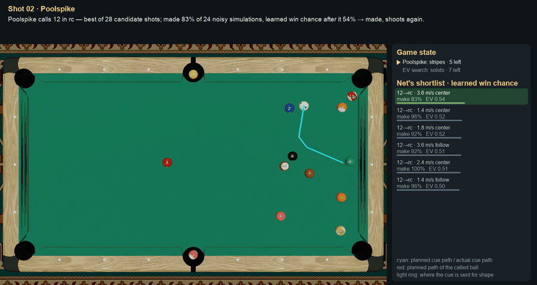
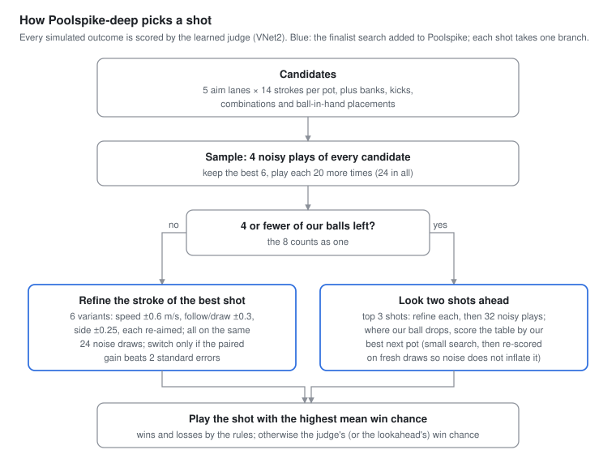

# Poolspike

**A self-play 8-ball player that beats the strongest hand-tuned search.**

Poolspike plays every candidate shot many times in a physics simulator with
execution noise. It scores each resulting table with a 2,354-parameter
win-probability network trained by self-play, then sharpens its best shots:
it fine-tunes the stroke, and late in the rack it looks one shot further
ahead. Every tournament champion since 2005 searched shots under noise and
scored the results with a hand-written formula. Poolspike keeps the search and
learns the evaluation, and sets a new state of the art over hand-tuned search:
it beats our rebuild of CueCard, the 2008 tournament champion, and our
strongest hand-written agent, EV.



*Poolspike (stripes) runs out against EV. Before each shot, the right panel
shows its shortlist: make rate over 24 noisy simulations and the judge's win
chance for each option. Full game, with sound:
[media/poolspike_vs_ev.mp4](media/poolspike_vs_ev.mp4). Render your own with
[`viz/`](viz/README.md). This game was played by the one-ply search
(`oneply`): Poolspike without the finalist search described below.*

| Match (95% intervals; a win counts 1) | Games | Poolspike score |
|---|---|---|
| vs CueCard rebuild | 1,000 | **0.666 ± 0.030** |
| vs CueCard rebuild, ICGA 2008 tournament noise | 400 | **0.688 ± 0.047** |
| vs EV (our strongest hand-written agent) | 1,000 | **0.662 ± 0.030** |

Extra compute does not explain the result: Poolspike without its finalist
search, given the same CPU, scores 0.441 ± 0.029 against it (see
[What each part is worth](#what-each-part-is-worth)).

## Background

In computer pool, a shot has five continuous parameters: aim, elevation, speed
and two cue-tip offsets for spin. Gaussian noise perturbs each one before the
physics runs, so a strong player must pick shots that still work when hit
imperfectly.

The ICGA computational pool tournaments (2005–2008) posed this problem in
8-ball:

- **PickPocket** (University of Alberta; [Smith, AAAI 2006](https://cdn.aaai.org/AAAI/2006/AAAI06-156.pdf)) won in 2005 and 2006.
- **CueCard** (Stanford) won in 2008, taking 64 of 78 games. It later beat
  PickPocket 492–144 ([Archibald et al., IJCAI 2009](https://www.ijcai.org/Proceedings/09/Papers/231.pdf)).

Both used search with a hand-written evaluation. CueCard's code was never
released, so we rebuilt it from its papers in our simulator. The rebuild
scores 0.940 against a greedy player and ties our EV agent (0.500 ± 0.057).

## How it works

Four ideas carry the method.

1. **Noise-aware sampling.** Poolspike builds candidates from 5 aim lanes ×
   14 strokes per pot, plus banks, kicks, combinations and ball-in-hand
   placements. It plays each one 4 times with noise, keeps the best 6, and
   plays those 20 more times. A shot is judged by how it lands, not how it
   was aimed.
2. **A learned judge.** Each landing position is scored as follows. The rules
   settle any win or loss. If the shooter keeps the table, the judge gives the
   shooter's win chance. If the turn passes, Poolspike uses 1 − the judge's
   score for the opponent. Poolspike plays the option with the highest mean
   win chance.
3. **Self-play with gating.** The judge is trained only on games Poolspike
   plays, mostly against itself. A refit judge must beat the current champion
   head to head before it replaces it, as in AlphaZero's loop.
4. **A sharper search on the finalists.** After the shortlist, Poolspike
   fine-tunes the stroke of its best shot. With four or fewer of its balls
   left, it instead refines its top 3 and scores each by its best next shot
   from the tables where the ball drops. There is no policy network and no
   tree search: the lookahead is one extra shot, late in the rack. Without
   this step, the player is the one-ply search (`oneply`).

### The search



- **Stroke refinement.** Around the best shot, Poolspike tries 6 variants:
  speed ±0.6 m/s, follow or draw ±0.3 and side spin ±0.25 cue-ball radii, each
  re-aimed. Every variant is played on the same 24 noise draws, so their
  difference is not luck. A variant replaces the stroke only if its paired
  gain beats 2 standard errors. This targets the one-ply search's measured
  weakness: when a much heavier search (7× CPU) disagreed with it, 47 of 63
  times it chose the same ball with a different stroke.
- **Late-rack lookahead.** With four or fewer of its balls left (the 8 counts
  as one), Poolspike refines its top 3 shots and plays each 32 times with
  noise. Where the ball drops, the judge's value of the table is replaced by
  the value of Poolspike's best next pot from it: a small search, with the
  pick re-scored on fresh noise draws so that taking the best of noisy
  estimates does not inflate it. In 150 self-play games of the one-ply search
  (1,798 shots), 71% of the win chance a player lost through its own shots
  was lost with one to four of its balls left.
- **Code:** `poolspike/poolspike_search.py`, on top of the one-ply player in
  `poolspike/poolspike_player.py`. It reproduces the logged games move for
  move.

### The judge (VNet2)

The judge is a deep-sets network, so it reads any number of balls in any
order:


- Each ball is described by 12 features: position, offset from the cue ball,
  best pot chance, pockets potted at better than even, open lanes, nearest
  ball and rail distance.
- A shared tanh encoder (12 → 16) maps each ball. The encodings are summed into
  three pools: own group, opponent's group and the 8-ball.
- The pools are joined with 17 standardized table features (65 inputs), then
  pass through a 32-unit tanh layer to a single logit.
- EV's analytic win estimate g₀ also feeds the output directly:

```
logit = 0.28 · g₀ + 0.59 + oᵀ tanh(W [ĝ; P_own; P_opp; P_8] + d)
```

The network learns only a correction to the hand-written estimate. That is why
2,354 parameters and about 7,600 games were enough.

### Training

Each round of `poolspike/train_selfplay.py`:

1. **Play.** The champion plays 300 self-play games at temperature 0.3, plus
   100 games against EV.
2. **Refit.** A new judge is trained on every position so far, starting from
   the champion's weights. Training uses logistic loss, Adam at 0.002,
   λ-return targets with λ = 0.7 and mirror augmentation.
3. **Gate.** The new judge plays the champion over 300 games. It is promoted
   only if it scores above 0.5.
4. **Check.** Every third round, the champion plays EV over 300 games.

The final judge was promoted in round 19 of 20. The 20 rounds took about 25
hours on a 10-core Mac mini. Only that final champion was then tested on
1,000 fresh games.

### What each part is worth

The judge is the larger lever:

| One-ply search, scored by | vs EV |
|---|---|
| EV's hand-written evaluation | 0.535 ± 0.069 (200 games) |
| the learned judge | 0.595 ± 0.030 (1,000 games) |

More of the same one-ply search does not help. With 2.3× the CPU (8 aim lanes,
shortlist 12, 8 + 80 noisy plays) it scored 0.533 against the standard
budget and 0.597 ± 0.030 against EV; with 7× (12 lanes, shortlist 24, 16 + 200
plays) it scored 0.540 ± 0.056 against the standard budget (300 games each).
Spending the compute on the finalists does help:

| Poolspike vs | Games | Poolspike score |
|---|---|---|
| the one-ply search with the same CPU (10 lanes, shortlist 16, 8 + 120 noisy plays; CPU ratio 1.03) | 1,000 | 0.559 ± 0.029 |

Against the CueCard rebuild, the one-ply search alone scored 0.583 ± 0.031
on the same 1,000 games where Poolspike scores 0.666; paired by rack,
Poolspike gains +0.083 ± 0.032.

How the search was chosen: each change was first played against the one-ply
search in a
sequential test (0.50 vs 0.55, 5% error rates), and a pass had to repeat on
fresh seeds. Stroke refinement alone passed twice (0.554, then 0.549; 1.3×
CPU). Lookahead on every shot without refinement was not shown to help (0.534
± 0.035 after 683 games, 6.2× CPU; stopped undecided). Refinement plus
lookahead late in the rack, which is Poolspike, passed twice (0.565, then
0.629; 4.0× CPU). Rejected at equal CPU: an ensemble of 5 judges (0.488), a
judge 4× wider (0.477), more ball-in-hand placements (0.505) and deliberate
safeties (0.495). Two further changes failed when played against Poolspike:
lookahead after likely misses (0.489 ± 0.046, 279 games) and a second, finer
round of stroke refinement (0.519 ± 0.041, 419 games; stopped undecided). A sequential test
stops when the score looks clear, which inflates it, so the scores in the
tables above all come from fixed-length runs. Logs: [`results/search/`](results/search/).

## Repository

```
bench/                  pool8-bench: self-contained benchmark. Start here (bench/README.md).
  match.py                seeded match runner, both seats per seed, 95% intervals
  example_agent.py        turn/action interface with an example agent to copy
  reference_agents.py     reference agents: greedy, ev, cc (CueCard rebuild), poolspike, oneply
  pool8/                  simulator wrapper, rules, noise, game engine (pooltool 0.6.0)
  ref/                    vendored copies of the agent code, weights and CueCard tables
  results/                RESULTS.md, CUECARD.md and per-game logs
  tools/                  results_table.py, judge_calibration.py
poolspike/              the player and its training
  poolspike_search.py     the player: stroke refinement and late-rack lookahead
  poolspike_player.py     the one-ply search underneath: candidates, noisy sampling, shortlist
  judge_net.py            the judge, plus data generation, fitting and evaluation
  train_selfplay.py       self-play training loop
  cuecard.py              CueCard rebuild (cc_data/: its precomputed tables)
  nets/v0.npz             starting judge
  nets/poolspike.npz      final Poolspike network (round 19)
sim/                    game engine, rules, physics wrapper and EV policy
results/                logs behind the reported numbers
  training/               20 rounds: loop.log, gate and EV-check games
  vs_cuecard/             one-ply search and CueCard matches, both noise models
  vs_ev/                  1,000-game one-ply search vs EV
  search/                 how the search was chosen: every candidate change, the equal-CPU test
  runout/                 run-out rate from 200 start positions
viz/                    render any game as a video with table sounds (viz/README.md)
media/                  the game above (GIF, and full video with sound), search and judge diagrams
```

Paths inside the logs in `results/` use development names (`wsp/`, `nets6/`,
`runs/v6`, `vnet2.py`, `shotnet5.py`); in game logs Poolspike is `rla_late`.

## Quick start

Requires Python 3.12. On Linux, see the note in `bench/pool8/requirements.txt`
about installing pooltool.

```bash
python3.12 -m venv .venv
.venv/bin/pip install -r bench/pool8/requirements.txt
cd bench
../.venv/bin/python -B match.py poolspike cc --seeds 600000 600010 --workers 4
```

That plays 20 games of Poolspike against the CueCard rebuild (`cc`). The
headline match is `--seeds 600000 600500 --workers 9`, about 3 hours on a
10-core Mac mini. Add `--noise icga2008 --rules icga` for tournament
conditions. To score your own agent, pass `py:path/to/file.py:factory`; see
`example_agent.py`.

To retrain (about 25 hours), first set `R` in `poolspike/train_selfplay.py`
to a new directory so the logs in `results/training` are not appended to,
then run from `poolspike/`:

```bash
../.venv/bin/python -B train_selfplay.py nets/v0.npz 20
```

## Evaluation protocol

- **Paired games.** Every seed is played twice, so each player breaks once.
  The two games share the rack and the noise stream, so neither side gets an
  easier rack. In practice this barely narrows the intervals: ±0.030 paired
  vs ±0.029 per game in the 1,000-game CueCard match.
- **Held-out seeds.** Reported matches use seeds 600000–604599, plus
  110000–110499 against EV. The judge trained on seeds below 50000, the search
  was chosen on seeds 810000–880499, and CueCard was debugged on
  603000–603214. No reported game was seen during development.
- **No access to the real noise.** The game draws its noise from its own
  random generator. Poolspike and the reference agents never read it; they
  plan with their own random numbers.

## Limitations

- **CueCard is a reimplementation.** Its code and the POOLFIZ simulator were
  never released. Our rebuild runs at about 1% of the original's simulation
  budget, and some parameters fill gaps the papers leave open.
- **One simulator.** All results are in
  [pooltool](https://github.com/ekiefl/pooltool). Transfer to other physics
  engines or real tables is untested.
- **Not learned from scratch.** The judge starts from EV's hand-written
  evaluation and learns a correction.
- **Some tournament rules are missing:** the four-balls-to-a-rail break, the
  8-ball as a legal first contact on an open table, and the game clock.
- **Compute.** Poolspike uses 5.3× the CueCard rebuild's CPU per shot, and
  the rebuild was not given more search.
- **Search tuned in self-play.** The search changes were selected in games
  against the one-ply search, not against CueCard or EV.
- **Small ablations.** The hand-written-evaluation comparison used only 200
  games, and the 2.3× and 7× search tests 300 each.

## References

- Archibald, Altman, Greenspan, Shoham. [Analysis of a Winning Computational Billiards Player](https://www.ijcai.org/Proceedings/09/Papers/231.pdf). IJCAI 2009.
- Archibald, Altman, Greenspan, Shoham. [Computational Pool: A New Challenge for Game Theory Pragmatics](https://aaai.org/ojs/index.php/aimagazine/article/view/2312). AI Magazine, 2010.
- Smith. [Running the Table: An AI for Computer Billiards](https://cdn.aaai.org/AAAI/2006/AAAI06-156.pdf). AAAI 2006.
- Kiefl. [pooltool: a billiards simulator](https://theoj.org/joss-papers/joss.07301/10.21105.joss.07301.pdf). JOSS.

## License

MIT, see [LICENSE](LICENSE).
